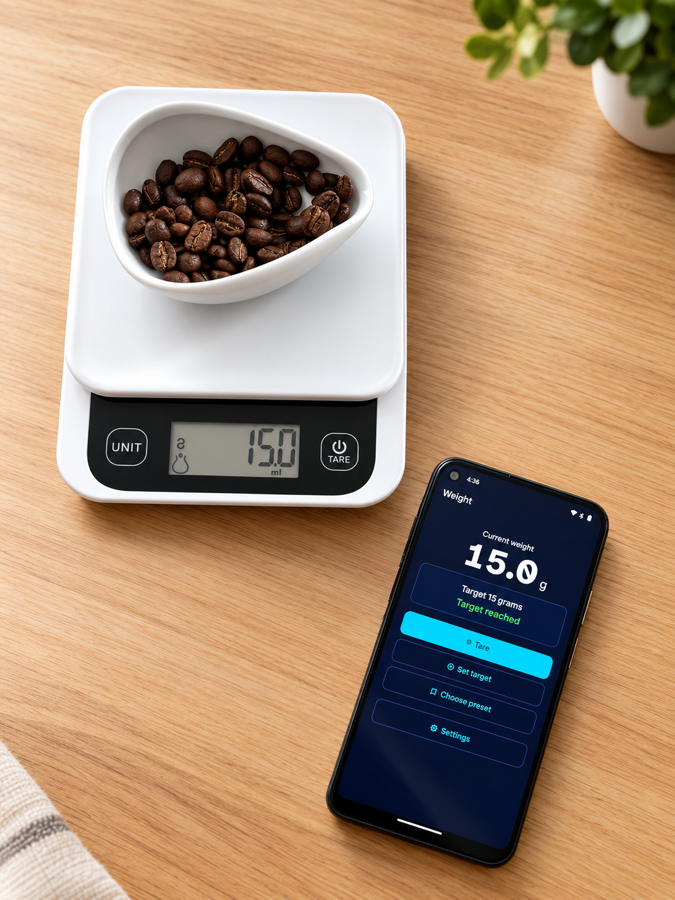
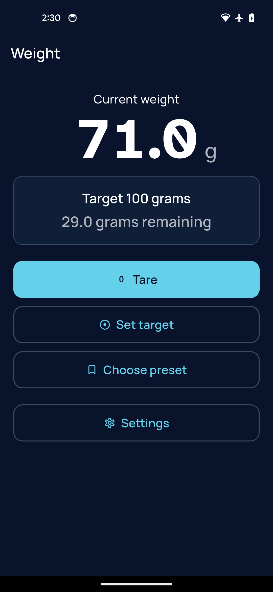
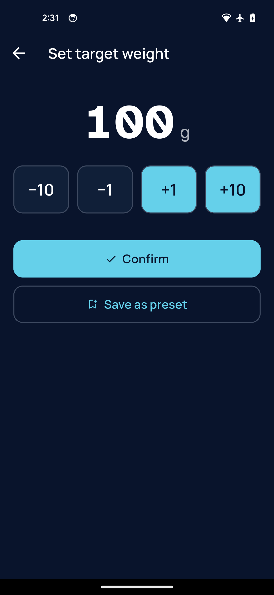
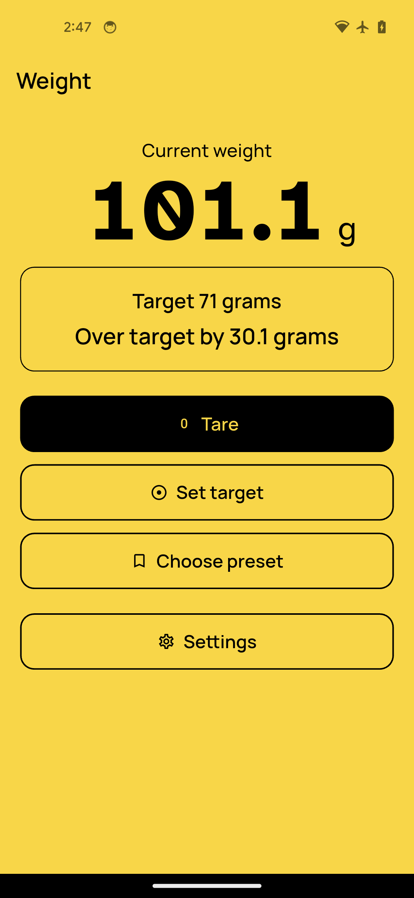

# NovaAccessScale

**Weigh by ear.** NovaAccessScale turns a Bluetooth kitchen scale into an
eyes-free tool — built for blind and low-vision users, it reads the weight
aloud and guides you toward a target with sound, vibration, and speech, so you
can measure to the gram without looking at the screen. Flour, sugar, pasta,
coffee: anything you weigh.

Measuring an ingredient is a small task that usually means asking someone for
help. It shouldn't have to. That's the whole point of this app.

Part of the [NovaAccessLabs](https://www.instagram.com/novaaccesslabs/)
family of accessibility tools.

  

| Weighing | Set a target | High contrast |
|---|---|---|
|  |  |  |

## Status

Android, not yet on Google Play — a submission is in progress. In the meantime,
grab the APK from
[Releases](https://github.com/NovaAccessLabs/nova-access-scale/releases).

No scale to hand? **Demo mode** runs the whole app against a simulated scale —
Settings › Connection.

## How it works

- Connect your Bluetooth scale.
- Set a target weight, or pick a saved preset.
- As you add weight, the app plays a soft tone that speeds up as you near the
  target. Sound is on by default; vibration can be added or used instead.
- When you pause, it speaks the grams remaining. A distinct cue marks "target
  reached" and "over target".

## Built for accessibility

- **Speaks through your screen reader.** When TalkBack is running,
  announcements use your own voice, speed, and language — and reach a
  braille display. The app's own voice is used only when no screen reader
  is active, so you're never left in silence.
- **Full screen-reader support** — clear labels, headings, and large touch
  targets throughout.
- **No sliders.** A simple stepper sets whole-gram targets.
- **Light and dark themes follow your system setting automatically**, plus a
  high-contrast switch (white on black, or black on yellow) for extra
  clarity.
- **Honors your device's text-size setting**, and respects the OS
  reduced-motion preference.
- Everything works by ear and by touch, not just by sight.

## Supported scales

**Smart Kitchen Scale / MyScale (model KP2048B)**, over Bluetooth — roughly
15–20 CHF, [available on AliExpress](https://s.click.aliexpress.com/e/_c3LmNnWV)
(affiliate link). The app itself is free. Other scales can be added — see below.

No scale yet? **Demo mode** runs the whole app against a simulated scale.

## Languages

English, Spanish, French, German, Italian — matched automatically to your
device's language, with English as the fallback. No language picker to set.

## Privacy

No account. No ads. No tracking. Your presets stay on your device. The app
talks only to your scale over Bluetooth. Full
[privacy policy](https://github.com/NovaAccessLabs/nova-access-scale/blob/main/PRIVACY.md).

## Contact

Questions, feedback, or ideas? novaaccesslabs@gmail.com ·
[@novaaccesslabs](https://www.instagram.com/novaaccesslabs/)

## Support the project

The app is free, with no ads and no tracking, and it stays that way. If it's
useful to you and you'd like to help keep NovaAccessLabs building accessibility
tools, you can support the work on
[Ko-fi](https://ko-fi.com/novaaccesslabs) — there's a link in the app's
Settings too. Sharing it with someone who'd use it helps just as much.

## Contributing

Built with Flutter, using
[`universal_ble`](https://pub.dev/packages/universal_ble) for Bluetooth. See
[`DEVELOPMENT.md`](DEVELOPMENT.md) for setup, architecture, and testing.

Adding support for another scale means implementing one interface —
`ScaleProtocol` is the only seam you touch, with no UI or controller changes.

## License

MIT — see [`LICENSE`](LICENSE). Bundled fonts (Manrope, Atkinson Hyperlegible)
are licensed under the SIL Open Font License 1.1; their license texts ship in
[`assets/fonts/`](assets/fonts/).
